# ACT Math Question Bank — Final Edition (245 Questions)

10 topic tests (20 questions each) + 1 combined test (45 questions). Har question ke saath options, answer key aur (jahan zaroorat) diagram hai. Diagrams `diagrams/` folder mein hain.

**Note:** 55 duplicate questions ko naye Medium-Hard/Hard level ke questions se replace kiya gaya hai (marked 🆕). Baaki 190 questions audit ke baad corrected hain; unmein se kai Easy level ke hain.

---

## Test 1: Coordinate Geometry (20 Questions)

**Q1.** Line ℓ passes through (1, 1) and (9, -2). What is its slope?

- **A.** 0
- **B.** 3/8
- **C.** −8/3
- **D.** −3/8

Answer
**D. −3/8**

**Q2.** What is the midpoint of the segment joining (-1, -5) and (-6, -6)?

- **A.** (2.5, 0.5)
- **B.** (-3.5, -5.5)
- **C.** (-7, -11)
- **D.** (-3.5, 0.5)

Answer
**B. (-3.5, -5.5)**

**Q3.** A circle has center (3, 1) and radius 7. Which equation represents it?

- **A.** (x − 3)² + (y − 1)² = 7
- **B.** (x − 3) + (y − 1) = 49
- **C.** (x − 3)² + (y − 1)² = 49
- **D.** (x + 3)² + (y + 1)² = 49

Answer
**C. (x − 3)² + (y − 1)² = 49**

**Q4.** A line has slope -3 and passes through (2, -2). What is its y-intercept?

- **A.** -4
- **B.** 3
- **C.** 1
- **D.** 4

Answer
**D. 4**

**Q5.** What is the distance between (2, -3) and (8, 3)?

- **A.** 6√2
- **B.** 6
- **C.** 12
- **D.** 72

Answer
**A. 6√2**

**Q6.** Which point lies on the line y = −2x?

- **A.** (2, −2)
- **B.** (−1, −2)
- **C.** (1, 0)
- **D.** (1, −2)

Answer
**D. (1, −2)**

**Q7.** The line 4x + 3y = -5 is perpendicular to which line?

- **A.** y = (3/4)x + 2
- **B.** y = (4/3)x + 3
- **C.** y = −(3/4)x + 1
- **D.** y = −(4/3)x − 1

Answer
**A. y = (3/4)x + 2**

**Q8.** Point P(2, -4) is translated by vector ⟨2, -2⟩. What are the new coordinates?

- **A.** (0, -6)
- **B.** (4, -6)
- **C.** (0, -2)
- **D.** (4, -2)

Answer
**B. (4, -6)**

**Q9.** If y = x + 2 and y = −x − 1 intersect at (x, y), what is x?

- **A.** −3
- **B.** 3
- **C.** 1/2
- **D.** −3/2

Answer
**D. −3/2**

**Q10.** The endpoints of a diameter are (−2, 4) and (6, −2). What is the circle's radius?

- **A.** 5
- **B.** 4
- **C.** √41
- **D.** 10

Answer
**A. 5**

**Q11.** Line ℓ passes through (-8, -1) and (-1, -8). What is its slope?

- **A.** 0
- **B.** −7
- **C.** −1
- **D.** 1

Answer
**C. −1**

**Q12.** What is the midpoint of the segment joining (5, 6) and (-3, -3)?

- **A.** (4, 4.5)
- **B.** (2, 3)
- **C.** (1, 1.5)
- **D.** (1, 4.5)

Answer
**C. (1, 1.5)**

**Q13.** A circle has center (-1, -1) and radius 4. Which equation represents it?

- **A.** (x + 1)² + (y + 1)² = 4
- **B.** (x − 1)² + (y − 1)² = 16
- **C.** (x + 1) + (y + 1) = 16
- **D.** (x + 1)² + (y + 1)² = 16

Answer
**D. (x + 1)² + (y + 1)² = 16**

**Q14.** A line has slope 2 and passes through (-3, 1). What is its y-intercept?

- **A.** 7
- **B.** 9
- **C.** 11
- **D.** -7

Answer
**A. 7**

**Q15.** What is the distance between (0, -4) and (4, -2)?

- **A.** 6
- **B.** 2√3
- **C.** 2
- **D.** 2√5

Answer
**D. 2√5**

**Q16.** Which point lies on the line y = -2x + 1?

- **A.** (-4, -7)
- **B.** (4, -7)
- **C.** (4, -5)
- **D.** (5, -7)

Answer
**B. (4, -7)**

**Q17.** The line 5x + 2y = 2 is perpendicular to which line?

- **A.** y = 2.5x + 3
- **B.** y = -2.5x − 1
- **C.** y = -0.4x + 1
- **D.** y = 0.4x + 2

Answer
**D. y = 0.4x + 2**

**Q18.** Point P(2, -3) is translated by vector ⟨5, -5⟩. What are the new coordinates?

- **A.** (7, 2)
- **B.** (-3, 2)
- **C.** (-3, -8)
- **D.** (7, -8)

Answer
**D. (7, -8)**

**Q19.** If y = 4x + 1 and y = −4x + 3 intersect at (x, y), what is x?

- **A.** −1/2
- **B.** 5/4
- **C.** 1/4
- **D.** 1/2

Answer
**C. 1/4**

**Q20.** 🆕 The point P(7, 1) lies on the circle (x − 3)² + (y + 2)² = 25. What is the slope of the line tangent to the circle at P?

- **A.** 3/4
- **B.** 4/3
- **C.** −3/4
- **D.** −4/3

Answer
**D. −4/3**

### Answer Key — Test 1: Coordinate Geometry

| Q | Ans | Answer |
|---|---|---|
| 1 | D | −3/8 |
| 2 | B | (-3.5, -5.5) |
| 3 | C | (x − 3)² + (y − 1)² = 49 |
| 4 | D | 4 |
| 5 | A | 6√2 |
| 6 | D | (1, −2) |
| 7 | A | y = (3/4)x + 2 |
| 8 | B | (4, -6) |
| 9 | D | −3/2 |
| 10 | A | 5 |
| 11 | C | −1 |
| 12 | C | (1, 1.5) |
| 13 | D | (x + 1)² + (y + 1)² = 16 |
| 14 | A | 7 |
| 15 | D | 2√5 |
| 16 | B | (4, -7) |
| 17 | D | y = 0.4x + 2 |
| 18 | D | (7, -8) |
| 19 | C | 1/4 |
| 20 | D | −4/3 |

---

## Test 2: Elementary Algebra (20 Questions)

**Q1.** Solve for x: 7x − 5 = −40.

- **A.** 5
- **B.** −7
- **C.** −4
- **D.** −5

Answer
**D. −5**

**Q2.** Solve: 4(x − 3) = -8.

- **A.** -1
- **B.** 4
- **C.** 1
- **D.** 3

Answer
**C. 1**

**Q3.** If 2x + 3 = 9, what is the value of 2x − 3?

- **A.** 3
- **B.** 5
- **C.** 0
- **D.** 9

Answer
**A. 3**

**Q4.** Simplify: 5(2a − 3) − a.

- **A.** 5a − 3
- **B.** 9a + 15
- **C.** 11a − 15
- **D.** 9a − 15

Answer
**D. 9a − 15**

**Q5.** Solve for x: 6x − 4 = 2.

- **A.** 2
- **B.** 0
- **C.** 1
- **D.** -1

Answer
**C. 1**

**Q6.** If 6x + 6y = 42 and x = 3, what is y?

- **A.** 3
- **B.** 24
- **C.** 4
- **D.** 5

Answer
**C. 4**

**Q7.** Factor completely: x² + 4x + 3.

- **A.** (x + 4)(x + 1)
- **B.** (x + 3)(x + 1)
- **C.** (x − 3)(x − 1)
- **D.** (x − 3)(x + 1)

Answer
**B. (x + 3)(x + 1)**

**Q8.** If x = 3, evaluate 2x² − 4x.

- **A.** 6
- **B.** 2
- **C.** 14
- **D.** 30

Answer
**A. 6**

**Q9.** Two consecutive integers have sum 15. What is the larger integer?

- **A.** 9
- **B.** 7
- **C.** 8
- **D.** 15

Answer
**C. 8**

**Q10.** If 3(2x − 1) = 2(x + 7), what is x?

- **A.** 5
- **B.** 7/2
- **C.** 11/4
- **D.** 17/4

Answer
**D. 17/4**

**Q11.** Solve for x: 8x + 2 = 58.

- **A.** −7
- **B.** 8
- **C.** 7
- **D.** 5

Answer
**C. 7**

**Q12.** Solve: 4(x − 6) = -28.

- **A.** 0
- **B.** 5
- **C.** −1
- **D.** 1

Answer
**C. −1**

**Q13.** If 5x + 3 = 8, what is the value of 2x − 3?

- **A.** 1
- **B.** 5
- **C.** -1
- **D.** -2

Answer
**C. -1**

**Q14.** Simplify: 8(2a − 2) − a.

- **A.** 15a − 16
- **B.** 15a + 16
- **C.** 17a − 16
- **D.** 8a − 2

Answer
**A. 15a − 16**

**Q15.** Solve for x: 5x − 2 = -17.

- **A.** -4
- **B.** -2
- **C.** 3
- **D.** -3

Answer
**D. -3**

**Q16.** If 6x + 5y = 44 and x = 4, what is y?

- **A.** 4
- **B.** 3
- **C.** 24
- **D.** 5

Answer
**A. 4**

**Q17.** Factor completely: x² + 7x + 12.

- **A.** (x + 3)(x + 4)
- **B.** (x + 7)(x + 1)
- **C.** (x − 3)(x − 4)
- **D.** (x − 3)(x + 4)

Answer
**A. (x + 3)(x + 4)**

**Q18.** If x = 0, evaluate 5x² − 3x.

- **A.** 0
- **B.** 1
- **C.** −3
- **D.** 2

Answer
**A. 0**

**Q19.** Two consecutive integers have sum 5. What is the larger integer?

- **A.** 4
- **B.** 5
- **C.** 2
- **D.** 3

Answer
**D. 3**

**Q20.** 🆕 The sum of three consecutive odd integers is 9 more than twice the largest of the three. What is the smallest of the three integers?

- **A.** 15
- **B.** 13
- **C.** 9
- **D.** 11

Answer
**D. 11**

### Answer Key — Test 2: Elementary Algebra

| Q | Ans | Answer |
|---|---|---|
| 1 | D | −5 |
| 2 | C | 1 |
| 3 | A | 3 |
| 4 | D | 9a − 15 |
| 5 | C | 1 |
| 6 | C | 4 |
| 7 | B | (x + 3)(x + 1) |
| 8 | A | 6 |
| 9 | C | 8 |
| 10 | D | 17/4 |
| 11 | C | 7 |
| 12 | C | −1 |
| 13 | C | -1 |
| 14 | A | 15a − 16 |
| 15 | D | -3 |
| 16 | A | 4 |
| 17 | A | (x + 3)(x + 4) |
| 18 | A | 0 |
| 19 | D | 3 |
| 20 | D | 11 |

---

## Test 3: Exponents & Radicals (20 Questions)

**Q1.** Simplify: x^3 · x^3.

- **A.** x^6
- **B.** x^9
- **C.** x^0
- **D.** 2x^6

Answer
**A. x^6**

**Q2.** Simplify: (y^6)^5.

- **A.** 30y
- **B.** y^1
- **C.** y^11
- **D.** y^30

Answer
**D. y^30**

**Q3.** For x ≠ 0, rewrite x^−3 / x^−5 using positive exponents.

- **A.** 1/x²
- **B.** x⁸
- **C.** x²
- **D.** 1/x⁸

Answer
**C. x²**

**Q4.** Simplify: √(625).

- **A.** 10
- **B.** 25√2
- **C.** 25
- **D.** 50

Answer
**C. 25**

**Q5.** Simplify: (27x^9)^(1/3).

- **A.** 9x^3
- **B.** 27x^3
- **C.** 3x^9
- **D.** 3x^3

Answer
**D. 3x^3**

**Q6.** If 2^x = 32, what is x?

- **A.** 4
- **B.** 16
- **C.** 6
- **D.** 5

Answer
**D. 5**

**Q7.** Simplify: √(4x²), assuming x < 0.

- **A.** 2x
- **B.** −2x
- **C.** 4x
- **D.** −4x

Answer
**B. −2x**

**Q8.** Evaluate: 16^(3/4).

- **A.** 8
- **B.** 64
- **C.** 4
- **D.** 12

Answer
**A. 8**

**Q9.** Simplify: (x^5y^4)²/(x^4y).

- **A.** x^4y^7
- **B.** x^7y^4
- **C.** x^6y^7
- **D.** x^9y^3

Answer
**C. x^6y^7**

**Q10.** If 9^x = 27, what is x?

- **A.** 3
- **B.** 1/2
- **C.** 3/2
- **D.** 2/3

Answer
**C. 3/2**

**Q11.** Simplify: x^3 · x^4.

- **A.** x^1
- **B.** x^12
- **C.** 2x^7
- **D.** x^7

Answer
**D. x^7**

**Q12.** Simplify: (y^3)^3.

- **A.** 9y
- **B.** y^6
- **C.** y^9
- **D.** y^0

Answer
**C. y^9**

**Q13.** Rewrite with positive exponents: x^−3/x^−2.

- **A.** 1/x
- **B.** 1/x⁵
- **C.** x⁵
- **D.** x

Answer
**A. 1/x**

**Q14.** Simplify: √(36).

- **A.** 5
- **B.** 12
- **C.** 6√2
- **D.** 6

Answer
**D. 6**

**Q15.** Simplify: (27x^18)^(1/3).

- **A.** 9x^6
- **B.** 3x^6
- **C.** 3x^18
- **D.** 27x^6

Answer
**B. 3x^6**

**Q16.** 🆕 If 2^(3x − 1) = 32^(x − 3), what is the value of x?

- **A.** 8
- **B.** 5
- **C.** −7
- **D.** 7

Answer
**D. 7**

**Q17.** Simplify: √(25x²), assuming x < 0.

- **A.** 5x
- **B.** −5x
- **C.** 25x
- **D.** −25x

Answer
**B. −5x**

**Q18.** 🆕 What is the value of (8^(2/3) · 27^(−1/3)) / 4^(−1/2)?

- **A.** 6
- **B.** 8/3
- **C.** 4/3
- **D.** 2/3

Answer
**B. 8/3**

**Q19.** Simplify: (x^3y^3)²/(x^2y).

- **A.** x^5y^3
- **B.** x^5y^2
- **C.** x^4y^5
- **D.** x^2y^5

Answer
**C. x^4y^5**

**Q20.** 🆕 For x > 0, the expression (x^(1/2) · x^(1/3)) / x^(1/6) equals x^k. What is k?

- **A.** 5/6
- **B.** 1
- **C.** 1/3
- **D.** 2/3

Answer
**D. 2/3**

### Answer Key — Test 3: Exponents & Radicals

| Q | Ans | Answer |
|---|---|---|
| 1 | A | x^6 |
| 2 | D | y^30 |
| 3 | C | x² |
| 4 | C | 25 |
| 5 | D | 3x^3 |
| 6 | D | 5 |
| 7 | B | −2x |
| 8 | A | 8 |
| 9 | C | x^6y^7 |
| 10 | C | 3/2 |
| 11 | D | x^7 |
| 12 | C | y^9 |
| 13 | A | 1/x |
| 14 | D | 6 |
| 15 | B | 3x^6 |
| 16 | D | 7 |
| 17 | B | −5x |
| 18 | B | 8/3 |
| 19 | C | x^4y^5 |
| 20 | D | 2/3 |

---

## Test 4: Intermediate Algebra (20 Questions)

**Q1.** Solve: x² − x − 2 = 0.

- **A.** x = −1 or −2
- **B.** x = −1 or 3
- **C.** x = 1 or −2
- **D.** x = −1 or 2

Answer
**D. x = −1 or 2**

**Q2.** What is the discriminant of 3x² + 7x + 3 = 0?

- **A.** -13
- **B.** 13
- **C.** 85
- **D.** 31

Answer
**B. 13**

**Q3.** If f(x)=x²+2x, what is f(5)?

- **A.** 35
- **B.** 7
- **C.** -35
- **D.** 37

Answer
**A. 35**

**Q4.** Solve the system: x + y = 10; x − y = -2. What is x?

- **A.** 10
- **B.** 4
- **C.** 6
- **D.** -2

Answer
**B. 4**

**Q5.** Which is equivalent to (x² − 25)/(x − 5), for x ≠ 5?

- **A.** x − 5
- **B.** x + 5
- **C.** x² + 5
- **D.** x + 25

Answer
**B. x + 5**

**Q6.** If log₂(x) = 6, what is x?

- **A.** 12
- **B.** 13
- **C.** 64
- **D.** 36

Answer
**C. 64**

**Q7.** Find the vertex's x-coordinate for y = 2x² − 16x + 7.

- **A.** 4
- **B.** 8
- **C.** −4
- **D.** 5

Answer
**A. 4**

**Q8.** Solve: |x − 3| = 1.

- **A.** x = ±1
- **B.** x = 4
- **C.** x = 2
- **D.** x = 2 or 4

Answer
**D. x = 2 or 4**

**Q9.** If f(x)=2x−1 and g(x)=x²+3, what is f(g(2))?

- **A.** 13
- **B.** 7
- **C.** 9
- **D.** 11

Answer
**A. 13**

**Q10.** For x ≠ −2, simplify (x² − 4)/(x² + 4x + 4).

- **A.** (x − 2)/(x + 2)
- **B.** x − 2
- **C.** 1
- **D.** (x + 2)/(x − 2)

Answer
**A. (x − 2)/(x + 2)**

**Q11.** Solve: x² − 6x = 0.

- **A.** x = 0 or 7
- **B.** x = 0 or −6
- **C.** x = 6
- **D.** x = 0 or 6

Answer
**D. x = 0 or 6**

**Q12.** What is the discriminant of 3x² + 4x + 1 = 0?

- **A.** -4
- **B.** 28
- **C.** 4
- **D.** 10

Answer
**C. 4**

**Q13.** If f(x)=x²+2x, what is f(0)?

- **A.** 2
- **B.** 0
- **C.** 1
- **D.** −2

Answer
**B. 0**

**Q14.** Solve the system: x + y = 8; x − y = 0. What is x?

- **A.** 4
- **B.** 0
- **C.** 8
- **D.** 5

Answer
**A. 4**

**Q15.** Which is equivalent to (x² − 9)/(x − 3), for x ≠ 3?

- **A.** x + 3
- **B.** x − 3
- **C.** x + 9
- **D.** x² + 3

Answer
**A. x + 3**

**Q16.** If log₂(x) = 3, what is x?

- **A.** 9
- **B.** 8
- **C.** 6
- **D.** 7

Answer
**B. 8**

**Q17.** Find the vertex's x-coordinate for y = 2x² − 24x + 7.

- **A.** 12
- **B.** −6
- **C.** 6
- **D.** 7

Answer
**C. 6**

**Q18.** Solve: |x − 3| = 2.

- **A.** x = 1 or 5
- **B.** x = ±2
- **C.** x = 1
- **D.** x = 5

Answer
**A. x = 1 or 5**

**Q19.** 🆕 Let f(x) = x² − 3x and g(x) = 2x + 1. For what positive value of x does f(g(x)) = g(f(x))?

- **A.** (−2 + √10)/2
- **B.** (−1 + √7)/2
- **C.** (2 + √10)/2
- **D.** (−2 + √10)/4

Answer
**A. (−2 + √10)/2**

**Q20.** 🆕 The equation kx² − 12x + 9 = 0 has exactly one real solution. What is the value of k?

- **A.** 3
- **B.** 4
- **C.** 9
- **D.** 12

Answer
**B. 4**

### Answer Key — Test 4: Intermediate Algebra

| Q | Ans | Answer |
|---|---|---|
| 1 | D | x = −1 or 2 |
| 2 | B | 13 |
| 3 | A | 35 |
| 4 | B | 4 |
| 5 | B | x + 5 |
| 6 | C | 64 |
| 7 | A | 4 |
| 8 | D | x = 2 or 4 |
| 9 | A | 13 |
| 10 | A | (x − 2)/(x + 2) |
| 11 | D | x = 0 or 6 |
| 12 | C | 4 |
| 13 | B | 0 |
| 14 | A | 4 |
| 15 | A | x + 3 |
| 16 | B | 8 |
| 17 | C | 6 |
| 18 | A | x = 1 or 5 |
| 19 | A | (−2 + √10)/2 |
| 20 | B | 4 |

---

## Test 5: Percentages (20 Questions)

**Q1.** A price of $840 is increased by 20% and then reduced by 20%. What is the final price?

- **A.** $873.60
- **B.** $806.40
- **C.** $840.00
- **D.** $672.00

Answer
**B. $806.40**

**Q2.** After a 18% discount, an item costs $615. What was its original price?

- **A.** $732
- **B.** $885
- **C.** $750
- **D.** $3416.67

Answer
**C. $750**

**Q3.** A quantity rises from 640 to 768. What is the percent increase?

- **A.** 16.7%
- **B.** 20%
- **C.** 80%
- **D.** 25%

Answer
**B. 20%**

**Q4.** 40% of a number is 336. What is the number?

- **A.** 2110
- **B.** 336
- **C.** 800
- **D.** 840

Answer
**D. 840**

**Q5.** A population of 640 increases by 30% and then by 20%. What is the overall percent increase?

- **A.** 56%
- **B.** 44%
- **C.** 50%
- **D.** 6%

Answer
**A. 56%**

**Q6.** An item costing $80 is sold at a 30% profit. What is its selling price?

- **A.** $24
- **B.** $56
- **C.** $110
- **D.** $104

Answer
**D. $104**

**Q7.** A test score improves from 64 to 76. What is the percent increase?

- **A.** 118.75%
- **B.** 12%
- **C.** 15.8%
- **D.** 18.75%

Answer
**D. 18.75%**

**Q8.** A value after a 20% decrease is 384. What was the original value?

- **A.** 480
- **B.** 96
- **C.** 576
- **D.** 460

Answer
**A. 480**

**Q9.** A store marks an item 40% above cost and then gives a 15% discount on the marked price. What is the profit percent?

- **A.** 25%
- **B.** 15%
- **C.** 34%
- **D.** 19%

Answer
**D. 19%**

**Q10.** A value is decreased by 20%. By what percent must the reduced value increase to return to the original?

- **A.** 30%
- **B.** 25%
- **C.** 22.5%
- **D.** 20%

Answer
**B. 25%**

**Q11.** A price of $840 is increased by 30% and then reduced by 30%. What is the final price?

- **A.** $764.40
- **B.** $915.60
- **C.** $840.00
- **D.** $588.00

Answer
**A. $764.40**

**Q12.** After a 20% discount, an item costs $600. What was its original price?

- **A.** $730
- **B.** $3000
- **C.** $900
- **D.** $750

Answer
**D. $750**

**Q13.** A quantity rises from 640 to 864. What is the percent increase?

- **A.** 35%
- **B.** 40%
- **C.** 65%
- **D.** 25.9%

Answer
**A. 35%**

**Q14.** 20% of a number is 166. What is the number?

- **A.** 166
- **B.** 4160
- **C.** 810
- **D.** 830

Answer
**D. 830**

**Q15.** A population of 240 increases by 20% and then by 10%. What is the overall percent increase?

- **A.** 2%
- **B.** 28%
- **C.** 30%
- **D.** 32%

Answer
**D. 32%**

**Q16.** An item costing $240 is sold at a 15% profit. What is its selling price?

- **A.** $204
- **B.** $276
- **C.** $255
- **D.** $36

Answer
**B. $276**

**Q17.** 🆕 A 40-liter solution is 25% alcohol. How many liters of pure alcohol must be added to make the solution 40% alcohol?

- **A.** 16
- **B.** 10
- **C.** 6
- **D.** 15

Answer
**B. 10**

**Q18.** A value after a 25% decrease is 562.5. What was the original value?

- **A.** 725
- **B.** 750
- **C.** 187.5
- **D.** 937.5

Answer
**B. 750**

**Q19.** 🆕 A price is increased by p% and then the new price is decreased by p%. The final price is 96% of the original price. What is p?

- **A.** 16
- **B.** 20
- **C.** 24
- **D.** 4

Answer
**B. 20**

**Q20.** 🆕 An investment of $2,000 earns 10% interest compounded annually. What is its value, in dollars, after 3 years?

- **A.** 2,640
- **B.** 2,600
- **C.** 2,700
- **D.** 2,662

Answer
**D. 2,662**

### Answer Key — Test 5: Percentages

| Q | Ans | Answer |
|---|---|---|
| 1 | B | $806.40 |
| 2 | C | $750 |
| 3 | B | 20% |
| 4 | D | 840 |
| 5 | A | 56% |
| 6 | D | $104 |
| 7 | D | 18.75% |
| 8 | A | 480 |
| 9 | D | 19% |
| 10 | B | 25% |
| 11 | A | $764.40 |
| 12 | D | $750 |
| 13 | A | 35% |
| 14 | D | 830 |
| 15 | D | 32% |
| 16 | B | $276 |
| 17 | B | 10 |
| 18 | B | 750 |
| 19 | B | 20 |
| 20 | D | 2,662 |

---

## Test 6: Plane Geometry (20 Questions)

**Q1.** A right triangle has legs 13 and 7. What is its area?

- **A.** 20
- **B.** 45.5
- **C.** 91
- **D.** 10

Answer
**B. 45.5**

**Q2.** A circle has radius 4. What is its area?

- **A.** 8π
- **B.** 4π
- **C.** 32π
- **D.** 16π

Answer
**D. 16π**

**Q3.** A square has diagonal 16√2. What is its perimeter?

- **A.** 64
- **B.** 16√2
- **C.** 128
- **D.** 32

Answer
**A. 64**

**Q4.** Two angles of a triangle measure 44° and 84°. What is the third angle?

- **A.** 60°
- **B.** 90°
- **C.** 52°
- **D.** 44°

Answer
**C. 52°**

**Q5.** A circle's circumference is 8π. What is its area?

- **A.** 32π
- **B.** 64π
- **C.** 4π
- **D.** 16π

Answer
**D. 16π**

**Q6.** A trapezoid has parallel bases 4 and 9 and height 9. Find its area.

- **A.** 117
- **B.** 162
- **C.** 58.5
- **D.** 6.5

Answer
**C. 58.5**

**Q7.** A 5-12-13 right triangle is enlarged by a scale factor of 3. What is the area of the enlarged triangle?

- **A.** 360
- **B.** 90
- **C.** 270
- **D.** 180

Answer
**C. 270**

**Q8.** An exterior angle of a triangle is 85°. One remote interior angle is 45°. What is the other remote interior angle?

- **A.** 45°
- **B.** 85°
- **C.** 40°
- **D.** 140°

Answer
**C. 40°**

**Q9.** A sector has radius 4 and central angle 90°. What is its area?

- **A.** 4π
- **B.** 32π
- **C.** 8π
- **D.** π

Answer
**A. 4π**

**Q10.** A rectangle has perimeter 48 and length 3 more than twice its width. What is its area?

- **A.** 119
- **B.** 144
- **C.** 96
- **D.** 150

Answer
**A. 119**

**Q11.** A right triangle has legs 9 and 3. What is its area?

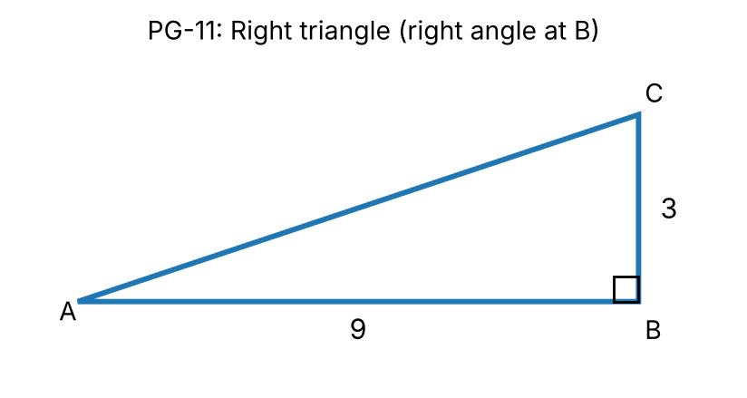

- **A.** 6
- **B.** 27
- **C.** 12
- **D.** 13.5

Answer
**D. 13.5**

**Q12.** 🆕 A circle is inscribed in a square with side length 12. What is the area of the region inside the square but outside the circle?

- **A.** 36π
- **B.** 144 − 36π
- **C.** 144 − 6π
- **D.** 144 − 12π

Answer
**B. 144 − 36π**

**Q13.** A square has diagonal 15√2. What is its perimeter?

- **A.** 60
- **B.** 15√2
- **C.** 120
- **D.** 30

Answer
**A. 60**

**Q14.** Two angles of a triangle measure 34° and 121°. What is the third angle?

- **A.** 30°
- **B.** 90°
- **C.** 60°
- **D.** 25°

Answer
**D. 25°**

**Q15.** A circle's circumference is 18π. What is its area?

- **A.** 324π
- **B.** 162π
- **C.** 9π
- **D.** 81π

Answer
**D. 81π**

**Q16.** A trapezoid has parallel bases 10 and 4 and height 5. Find its area.

- **A.** 70
- **B.** 35
- **C.** 100
- **D.** 7

Answer
**B. 35**

**Q17.** 🆕 In triangle ABC, AB = AC = 13 and BC = 10. What is the area of the triangle?

- **A.** 60
- **B.** 65
- **C.** 78
- **D.** 120

Answer
**A. 60**

**Q18.** An exterior angle of a triangle is 101°. One remote interior angle is 61°. What is the other remote interior angle?

- **A.** 40°
- **B.** 101°
- **C.** 61°
- **D.** 140°

Answer
**A. 40°**

**Q19.** A sector has radius 7 and central angle 90°. What is its area?

- **A.** 49π/2
- **B.** 7π/4
- **C.** 98π
- **D.** 49π/4

Answer
**D. 49π/4**

**Q20.** 🆕 What is the area of a regular hexagon with side length 4?

- **A.** 24
- **B.** 48√3
- **C.** 24√3
- **D.** 16√3

Answer
**C. 24√3**

### Answer Key — Test 6: Plane Geometry

| Q | Ans | Answer |
|---|---|---|
| 1 | B | 45.5 |
| 2 | D | 16π |
| 3 | A | 64 |
| 4 | C | 52° |
| 5 | D | 16π |
| 6 | C | 58.5 |
| 7 | C | 270 |
| 8 | C | 40° |
| 9 | A | 4π |
| 10 | A | 119 |
| 11 | D | 13.5 |
| 12 | B | 144 − 36π |
| 13 | A | 60 |
| 14 | D | 25° |
| 15 | D | 81π |
| 16 | B | 35 |
| 17 | A | 60 |
| 18 | A | 40° |
| 19 | D | 49π/4 |
| 20 | C | 24√3 |

---

## Test 7: Pre-Algebra (20 Questions)

**Q1.** Evaluate: 9 − 2(7 − 9).

- **A.** 13
- **B.** 4
- **C.** -14
- **D.** -13

Answer
**A. 13**

**Q2.** Compute: 4/8 + 8/4.

- **A.** 5/2
- **B.** 1
- **C.** 8/3
- **D.** 3/8

Answer
**A. 5/2**

**Q3.** What is the least common multiple of 4 and 10?

- **A.** 40
- **B.** 14
- **C.** 2
- **D.** 20

Answer
**D. 20**

**Q4.** Evaluate |−9| − |9 − 2·9|.

- **A.** 9
- **B.** 18
- **C.** 0
- **D.** -9

Answer
**C. 0**

**Q5.** Convert 6/2 to a decimal rounded to the nearest hundredth.

- **A.** 3.00
- **B.** 0.33
- **C.** 2.90
- **D.** 3.10

Answer
**A. 3.00**

**Q6.** If 4x − 7 = 29, what is 3x + 2?

- **A.** 38
- **B.** 25
- **C.** 11
- **D.** 29

Answer
**D. 29**

**Q7.** Order from least to greatest: 2/10, 7/8, 0.65.

- **A.** 0.20, 0.875, 0.65
- **B.** 0.20, 0.65, 0.875
- **C.** 0.875, 0.20, 0.65
- **D.** 0.65, 0.20, 0.875

Answer
**B. 0.20, 0.65, 0.875**

**Q8.** Evaluate: (5² − 3²)/(5 − 3).

- **A.** 2
- **B.** 8
- **C.** 16
- **D.** 34

Answer
**B. 8**

**Q9.** A car travels 3/5 of a 450-mile route. How many miles remain?

- **A.** 180
- **B.** 270
- **C.** 90
- **D.** 300

Answer
**A. 180**

**Q10.** If 0.08 = n/250, what is n?

- **A.** 20
- **B.** 12.5
- **C.** 31.25
- **D.** 2

Answer
**A. 20**

**Q11.** Evaluate: 3 − 2(8 − 3).

- **A.** -10
- **B.** -7
- **C.** 7
- **D.** -16

Answer
**B. -7**

**Q12.** Compute: 3/8 + 8/3.

- **A.** 24/11
- **B.** 1
- **C.** 11/24
- **D.** 73/24

Answer
**D. 73/24**

**Q13.** What is the least common multiple of 7 and 16?

- **A.** 23
- **B.** 113
- **C.** 1
- **D.** 112

Answer
**D. 112**

**Q14.** Evaluate |−8| − |8 − 2·8|.

- **A.** 0
- **B.** 16
- **C.** -8
- **D.** 8

Answer
**A. 0**

**Q15.** Convert 8/7 to a decimal rounded to the nearest hundredth.

- **A.** 1.14
- **B.** 0.88
- **C.** 1.24
- **D.** 1.04

Answer
**A. 1.14**

**Q16.** 🆕 The average of 5 numbers is 18. When one of the numbers is removed, the average of the remaining 4 numbers is 16. What number was removed?

- **A.** 26
- **B.** 2
- **C.** 34
- **D.** 90

Answer
**A. 26**

**Q17.** Order from least to greatest: 6/10, 8/8, 0.65.

- **A.** 0.65, 0.60, 1.000
- **B.** 0.60, 0.65, 1.000
- **C.** 0.60, 1.000, 0.65
- **D.** 1.000, 0.60, 0.65

Answer
**B. 0.60, 0.65, 1.000**

**Q18.** Evaluate: (3² − 6²)/(3 − 6), assuming 3 ≠ 6.

- **A.** 45
- **B.** 18
- **C.** -3
- **D.** 9

Answer
**D. 9**

**Q19.** A car travels 3/5 of a 150-mile route. How many miles remain?

- **A.** 90
- **B.** 30
- **C.** 60
- **D.** 150

Answer
**C. 60**

**Q20.** 🆕 How many positive integers less than 100 are divisible by 3 or by 5?

- **A.** 52
- **B.** 33
- **C.** 55
- **D.** 46

Answer
**D. 46**

### Answer Key — Test 7: Pre-Algebra

| Q | Ans | Answer |
|---|---|---|
| 1 | A | 13 |
| 2 | A | 5/2 |
| 3 | D | 20 |
| 4 | C | 0 |
| 5 | A | 3.00 |
| 6 | D | 29 |
| 7 | B | 0.20, 0.65, 0.875 |
| 8 | B | 8 |
| 9 | A | 180 |
| 10 | A | 20 |
| 11 | B | -7 |
| 12 | D | 73/24 |
| 13 | D | 112 |
| 14 | A | 0 |
| 15 | A | 1.14 |
| 16 | A | 26 |
| 17 | B | 0.60, 0.65, 1.000 |
| 18 | D | 9 |
| 19 | C | 60 |
| 20 | D | 46 |

---

## Test 8: Ratios & Proportions (20 Questions)

**Q1.** The ratio of A to B is 5:7. If A + B = 96, what is A?

- **A.** 20
- **B.** 56
- **C.** 40
- **D.** 47

Answer
**C. 40**

**Q2.** If  2/8 = x/6, what is x?

- **A.** 8/3
- **B.** 1.5
- **C.** 16
- **D.** 24

Answer
**B. 1.5**

**Q3.** A map uses 1 inch to represent 28 miles. How many miles does 3.5 inches represent?

- **A.** 98
- **B.** 73.5
- **C.** 24.5
- **D.** 49

Answer
**A. 98**

**Q4.** Two quantities are in the ratio 5:3 and sum to 40. What is the larger quantity?

- **A.** 40/3
- **B.** 15
- **C.** 8
- **D.** 25

Answer
**D. 25**

**Q5.** A solution contains 7 parts acid for every 5 parts water. If the total is 120 liters, how many liters are water?

- **A.** 24
- **B.** 50
- **C.** 70
- **D.** 35

Answer
**B. 50**

**Q6.** Workers complete a job in 12 days at 3 workers. At the same rate, how many days would 6 workers need?

- **A.** 3
- **B.** 6
- **C.** 24
- **D.** 12

Answer
**B. 6**

**Q7.** Divide $1100 in the ratio 3:8. What is the smaller share?

- **A.** 1100
- **B.** 300
- **C.** 150
- **D.** 800

Answer
**B. 300**

**Q8.** A recipe for 8 servings uses 3 cups of rice. How many cups are needed for 14 servings?

- **A.** 5
- **B.** 4.5
- **C.** 6
- **D.** 5.25

Answer
**D. 5.25**

**Q9.** A machine makes 180 parts in 4 minutes. At the same rate, how many parts does it make in 11 minutes?

- **A.** 450
- **B.** 495
- **C.** 440
- **D.** 540

Answer
**B. 495**

**Q10.** The ratio of boys to girls is 7:5. If there are 96 students, how many are girls?

- **A.** 40
- **B.** 35
- **C.** 48
- **D.** 56

Answer
**A. 40**

**Q11.** The ratio of A to B is 5:9. If A + B = 154, what is A?

- **A.** 99
- **B.** 25
- **C.** 55
- **D.** 64

Answer
**C. 55**

**Q12.** If  6/4 = x/7, what is x?

- **A.** 24/7
- **B.** 14/3
- **C.** 17
- **D.** 10.5

Answer
**D. 10.5**

**Q13.** A map uses 1 inch to represent 12 miles. How many miles does 3.5 inches represent?

- **A.** 42
- **B.** 21
- **C.** 31.5
- **D.** 10.5

Answer
**A. 42**

**Q14.** Two quantities are in the ratio 5:7 and sum to 60. What is the larger quantity?

- **A.** 25
- **B.** 35
- **C.** 12
- **D.** 60/7

Answer
**B. 35**

**Q15.** A solution contains 4 parts acid for every 5 parts water. If the total is 90 liters, how many liters are water?

- **A.** 18
- **B.** 50
- **C.** 20
- **D.** 40

Answer
**B. 50**

**Q16.** Workers complete a job in 12 days at 2 workers. At the same rate, how many days would 4 workers need?

- **A.** 3
- **B.** 12
- **C.** 6
- **D.** 24

Answer
**C. 6**

**Q17.** Divide $800 in the ratio 3:5. What is the smaller share?

- **A.** 500
- **B.** 300
- **C.** 800
- **D.** 150

Answer
**B. 300**

**Q18.** 🆕 Pipe A fills a tank in 6 hours and pipe B fills it in 12 hours. A drain C empties the full tank in 18 hours. With all three open, how many hours does it take to fill the empty tank?

- **A.** 36/5
- **B.** 9
- **C.** 4
- **D.** 36/7

Answer
**D. 36/7**

**Q19.** 🆕 If a : b = 3 : 4 and b : c = 6 : 5, what is a : c?

- **A.** 9 : 10
- **B.** 3 : 5
- **C.** 2 : 3
- **D.** 4 : 5

Answer
**A. 9 : 10**

**Q20.** 🆕 A car drives the first 120 miles of a trip at 40 mph and the next 120 miles at 60 mph. What is its average speed for the whole 240 miles?

- **A.** 52 mph
- **B.** 45 mph
- **C.** 50 mph
- **D.** 48 mph

Answer
**D. 48 mph**

### Answer Key — Test 8: Ratios & Proportions

| Q | Ans | Answer |
|---|---|---|
| 1 | C | 40 |
| 2 | B | 1.5 |
| 3 | A | 98 |
| 4 | D | 25 |
| 5 | B | 50 |
| 6 | B | 6 |
| 7 | B | 300 |
| 8 | D | 5.25 |
| 9 | B | 495 |
| 10 | A | 40 |
| 11 | C | 55 |
| 12 | D | 10.5 |
| 13 | A | 42 |
| 14 | B | 35 |
| 15 | B | 50 |
| 16 | C | 6 |
| 17 | B | 300 |
| 18 | D | 36/7 |
| 19 | A | 9 : 10 |
| 20 | D | 48 mph |

---

## Test 9: Statistics & Probability (20 Questions)

**Q1.** For the data set 5, 10, 18, 30, 39, what is the median?

- **A.** 20.4
- **B.** 30
- **C.** 18
- **D.** 10

Answer
**C. 18**

**Q2.** A fair die is rolled twice. What is the probability that the sum is 5?

- **A.** 1/6
- **B.** 1/36
- **C.** 1/12
- **D.** 1/9

Answer
**D. 1/9**

**Q3.** A data set has mean 6 for 3 values. What is the total of the values?

- **A.** 9
- **B.** 21
- **C.** 2
- **D.** 18

Answer
**D. 18**

**Q4.** A bag contains 5 red, 4 blue, and 3 green marbles. Two are drawn without replacement. What is P(both blue)?

- **A.** 1/11
- **B.** 1/9
- **C.** 2/11
- **D.** 1/6

Answer
**A. 1/11**

**Q5.** The mean of 5 numbers is 12. Four numbers sum to 57. What is the fifth number?

- **A.** 57
- **B.** 3
- **C.** 15
- **D.** 9

Answer
**B. 3**

**Q6.** A class has 12 students with mean score 80 and 8 students with mean score 90. What is the combined mean?

- **A.** 85
- **B.** 84
- **C.** 82
- **D.** 86

Answer
**B. 84**

**Q7.** A box has 4 defective and 16 nondefective items. One item is selected at random. What is the probability it is nondefective?

- **A.** 4/5
- **B.** 1/5
- **C.** 3/5
- **D.** 3/4

Answer
**A. 4/5**

**Q8.** A value is selected uniformly from integers 1 through 16. What is the probability it is a multiple of 8?

- **A.** 2/3
- **B.** 1/8
- **C.** 1/4
- **D.** 1/3

Answer
**B. 1/8**

**Q9.** If the standard deviation of a data set is 0, which must be true?

- **A.** The mean is 0
- **B.** All data values are identical
- **C.** There is exactly one data value
- **D.** The median is 0

Answer
**B. All data values are identical**

**Q10.** A committee of 2 is chosen from 5 students. How many different committees are possible?

- **A.** 20
- **B.** 10
- **C.** 25
- **D.** 5

Answer
**B. 10**

**Q11.** For the data set 7, 18, 22, 27, 35, what is the median?

- **A.** 22
- **B.** 21.8
- **C.** 27
- **D.** 18

Answer
**A. 22**

**Q12.** A fair die is rolled twice. What is the probability the sum is 6?

- **A.** 1/6
- **B.** 1/36
- **C.** 1/12
- **D.** 5/36

Answer
**D. 5/36**

**Q13.** A data set has mean 8 for 6 values. What is the total of the values?

- **A.** 4/3
- **B.** 14
- **C.** 54
- **D.** 48

Answer
**D. 48**

**Q14.** 🆕 The scatter plot shows the number of study hours (x) and the test score (y) of 8 students. What is the median score of the 8 students?

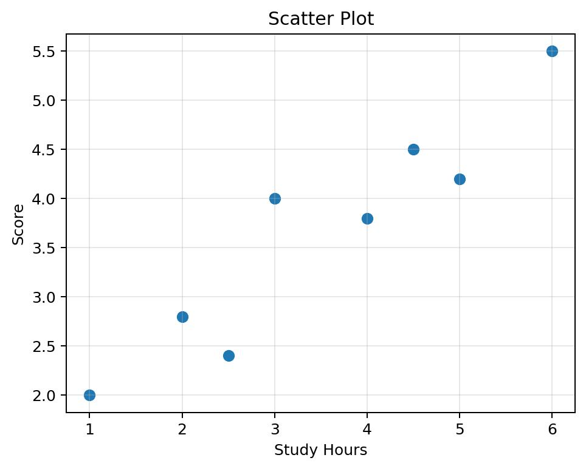

- **A.** 3.8
- **B.** 3.9
- **C.** 4.0
- **D.** 3.65

Answer
**B. 3.9**

**Q15.** 🆕 In the scatter plot, a line is drawn through the points (1, 2.0) and (6, 5.5). For the student who studied 4 hours, by how much does the actual score differ from the score predicted by the line?

- **A.** 0.7
- **B.** 0.1
- **C.** 0.5
- **D.** 0.3

Answer
**D. 0.3**

**Q16.** 🆕 A fair coin is tossed 3 times. The tree diagram shows the first two tosses. What is the probability of getting exactly 2 heads in the 3 tosses?

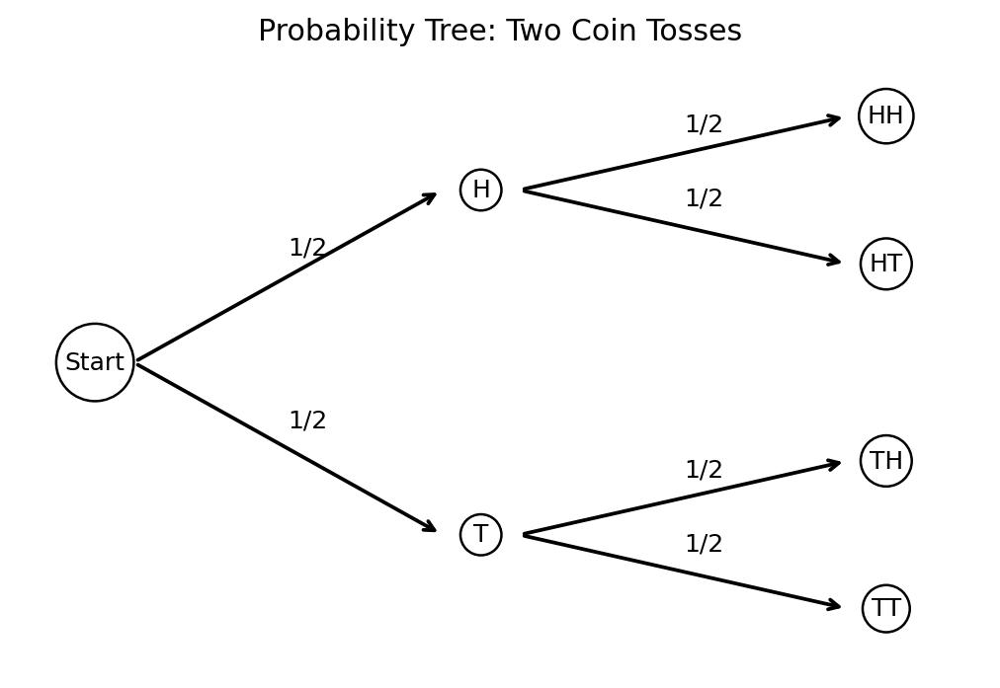

- **A.** 3/8
- **B.** 1/4
- **C.** 3/4
- **D.** 1/2

Answer
**A. 3/8**

**Q17.** 🆕 Two cards are drawn without replacement from 10 cards numbered 1 through 10. What is the probability that the sum of the two numbers is even?

- **A.** 2/9
- **B.** 5/9
- **C.** 1/2
- **D.** 4/9

Answer
**D. 4/9**

**Q18.** A value is selected uniformly from integers 1 through 6. What is the probability it is a multiple of 3?

- **A.** 1/3
- **B.** 1/2
- **C.** 2/3
- **D.** 1/4

Answer
**A. 1/3**

**Q19.** 🆕 The data set 4, 7, 7, x, 12 has a mean of 8. What is the median of the data set?

- **A.** 7
- **B.** 10
- **C.** 8
- **D.** 7.5

Answer
**A. 7**

**Q20.** 🆕 How many distinct arrangements of all the letters of the word BALLOON are possible?

- **A.** 2,520
- **B.** 5,040
- **C.** 630
- **D.** 1,260

Answer
**D. 1,260**

### Answer Key — Test 9: Statistics & Probability

| Q | Ans | Answer |
|---|---|---|
| 1 | C | 18 |
| 2 | D | 1/9 |
| 3 | D | 18 |
| 4 | A | 1/11 |
| 5 | B | 3 |
| 6 | B | 84 |
| 7 | A | 4/5 |
| 8 | B | 1/8 |
| 9 | B | All data values are identical |
| 10 | B | 10 |
| 11 | A | 22 |
| 12 | D | 5/36 |
| 13 | D | 48 |
| 14 | B | 3.9 |
| 15 | D | 0.3 |
| 16 | A | 3/8 |
| 17 | D | 4/9 |
| 18 | A | 1/3 |
| 19 | A | 7 |
| 20 | D | 1,260 |

---

## Test 10: Trigonometry (20 Questions)

**Q1.** In a right triangle, sin θ = 5/13 and θ is acute. What is cos θ?

- **A.** 12/5
- **B.** 13/12
- **C.** 5/12
- **D.** 12/13

Answer
**D. 12/13**

**Q2.** If tan θ = 7/24 for an acute angle θ, what is sin θ?

- **A.** 25/7
- **B.** 24/25
- **C.** 7/25
- **D.** 7/24

Answer
**C. 7/25**

**Q3.** What is the exact value of sin 30° + cos 60°?

- **A.** 0
- **B.** 1
- **C.** 1/2
- **D.** √3

Answer
**B. 1**

**Q4.** If cos θ = 0.6 and θ is acute, what is tan θ?

- **A.** 4/3
- **B.** 5/3
- **C.** 3/4
- **D.** 3/5

Answer
**A. 4/3**

**Q5.** A 20-foot ladder makes a 60° angle with the ground. How high up a wall does it reach?

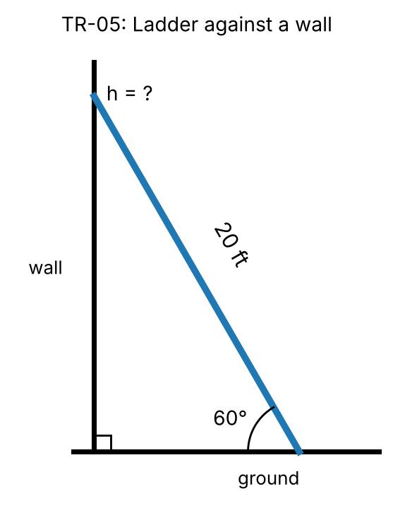

- **A.** 10 ft
- **B.** 5√3 ft
- **C.** 10√3 ft
- **D.** 20√3 ft

Answer
**C. 10√3 ft**

**Q6.** For an acute θ, if sin θ = cos(2θ), what is θ?

- **A.** 60°
- **B.** 30°
- **C.** 45°
- **D.** 15°

Answer
**B. 30°**

**Q7.** What is the amplitude of y = −4 sin(3x) + 2?

- **A.** 2
- **B.** −4
- **C.** 4
- **D.** 3

Answer
**C. 4**

**Q8.** What is the period of y = cos(2x) when x is measured in radians?

- **A.** 2π
- **B.** π/2
- **C.** 4π
- **D.** π

Answer
**D. π**

**Q9.** A 15-m pole casts a shadow 5√3 m long. What is the sun's angle of elevation?

- **A.** 45°
- **B.** 60°
- **C.** 30°
- **D.** 75°

Answer
**B. 60°**

**Q10.** If tan θ = 1 and 0° < θ < 90°, what is sin(2θ)?

- **A.** 0
- **B.** 1/2
- **C.** √2/2
- **D.** 1

Answer
**D. 1**

**Q11.** 🆕 If sin θ + cos θ = 7/5, what is the value of sin θ · cos θ?

- **A.** 12/25
- **B.** 24/25
- **C.** 1/5
- **D.** 7/25

Answer
**A. 12/25**

**Q12.** 🆕 From a point 100 feet from the base of a building, the angle of elevation to the top of the building is 40° and to the top of a flagpole on the roof is 50°. To the nearest tenth of a foot, how tall is the flagpole?

- **A.** 28.4
- **B.** 19.2
- **C.** 42.6
- **D.** 35.3

Answer
**D. 35.3**

**Q13.** 🆕 If tan θ = 3/4 and θ is in Quadrant III, what is cos θ?

- **A.** 4/5
- **B.** −3/4
- **C.** −3/5
- **D.** −4/5

Answer
**D. −4/5**

**Q14.** 🆕 What is the period of y = 3cos(πx/2) + 1?

- **A.** π
- **B.** 8
- **C.** 2
- **D.** 4

Answer
**D. 4**

**Q15.** 🆕 A 26-foot ladder leans against a wall with its base 10 feet from the wall. To the nearest degree, what angle does the ladder make with the ground?

- **A.** 23°
- **B.** 67°
- **C.** 38°
- **D.** 57°

Answer
**B. 67°**

**Q16.** 🆕 A triangle has two sides of lengths 7 and 8 with a 60° angle between them. What is the length of the third side?

- **A.** √113
- **B.** 15
- **C.** √169
- **D.** √57

Answer
**D. √57**

**Q17.** 🆕 What is the area of a triangle with two sides of length 6 and 9 and an included angle of 30°?

- **A.** 27
- **B.** 27√3/2
- **C.** 27/4
- **D.** 27/2

Answer
**D. 27/2**

**Q18.** 🆕 If sin x = 3/5 and 0° < x < 90°, what is sin 2x?

- **A.** 7/25
- **B.** 12/25
- **C.** 6/5
- **D.** 24/25

Answer
**D. 24/25**

**Q19.** 🆕 What is the maximum value of y = 5 − 3cos(2x)?

- **A.** 8
- **B.** 2
- **C.** 11
- **D.** 5

Answer
**A. 8**

**Q20.** 🆕 How many solutions does sin(2x) = 1/2 have for 0 ≤ x < 2π?

- **A.** 4
- **B.** 2
- **C.** 3
- **D.** 6

Answer
**A. 4**

### Answer Key — Test 10: Trigonometry

| Q | Ans | Answer |
|---|---|---|
| 1 | D | 12/13 |
| 2 | C | 7/25 |
| 3 | B | 1 |
| 4 | A | 4/3 |
| 5 | C | 10√3 ft |
| 6 | B | 30° |
| 7 | C | 4 |
| 8 | D | π |
| 9 | B | 60° |
| 10 | D | 1 |
| 11 | A | 12/25 |
| 12 | D | 35.3 |
| 13 | D | −4/5 |
| 14 | D | 4 |
| 15 | B | 67° |
| 16 | D | √57 |
| 17 | D | 27/2 |
| 18 | D | 24/25 |
| 19 | A | 8 |
| 20 | A | 4 |

---

## Test 11: Combined Test (mixed) (45 Questions)

**Q1.** What is the midpoint of the segment joining (4, 1) and (2, 2)?

- **A.** (3, 1.5)
- **B.** (6, 3)
- **C.** (3, -0.5)
- **D.** (1, -0.5)

Answer
**A. (3, 1.5)**

**Q2.** If 4x + 1 = 13, what is the value of 2x − 3?

- **A.** 0
- **B.** 5
- **C.** 9
- **D.** 3

Answer
**D. 3**

**Q3.** Simplify: √(64).

- **A.** 16
- **B.** 8
- **C.** 8√2
- **D.** 6

Answer
**B. 8**

**Q4.** 🆕 The graph of y = x² − 2x − 1 is shown, with vertex (1, −2). For which values of x does y = 2?

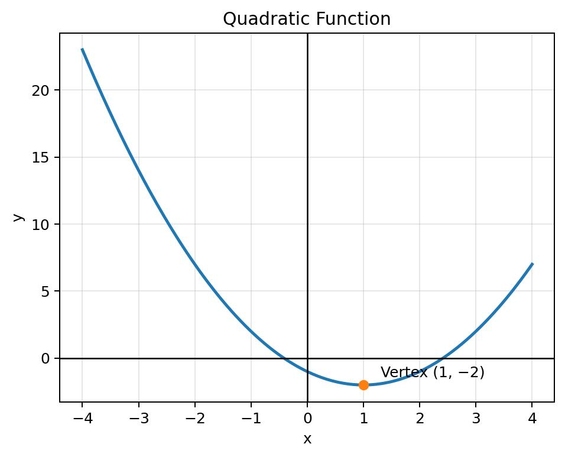

- **A.** x = 1 or 3
- **B.** x = −1 or 1
- **C.** x = −3 or 1
- **D.** x = −1 or 3

Answer
**D. x = −1 or 3**

**Q5.** An item costing $150 is sold at a 20% profit. What is its selling price?

- **A.** $120
- **B.** $30
- **C.** $170
- **D.** $180

Answer
**D. $180**

**Q6.** 🆕 The line shown passes through (−4, −2) and (4, 4). What is its x-intercept?

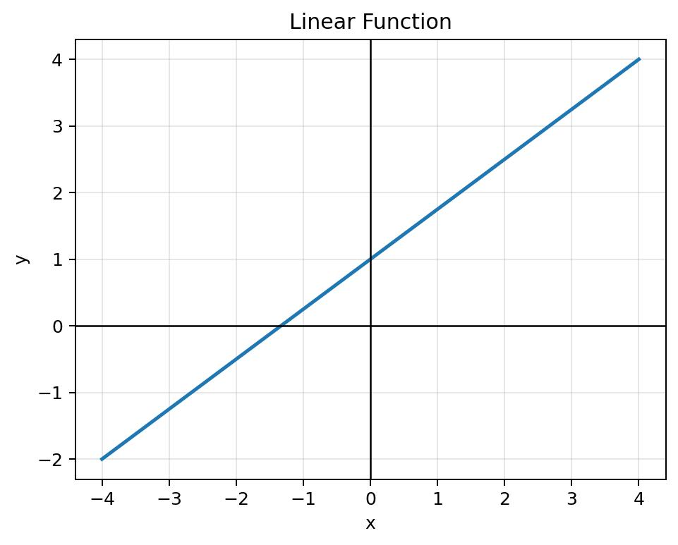

- **A.** −1
- **B.** 4/3
- **C.** −4/3
- **D.** −3/4

Answer
**C. −4/3**

**Q7.** Evaluate: (4² − 2²)/(4 − 2), assuming 4 ≠ 2.

- **A.** 2
- **B.** 20
- **C.** 6
- **D.** 8

Answer
**C. 6**

**Q8.** 🆕 Points A(−3, 1) and B(5, 5) are shown. Point C lies on the y-axis and is the same distance from A and from B. What are the coordinates of C?

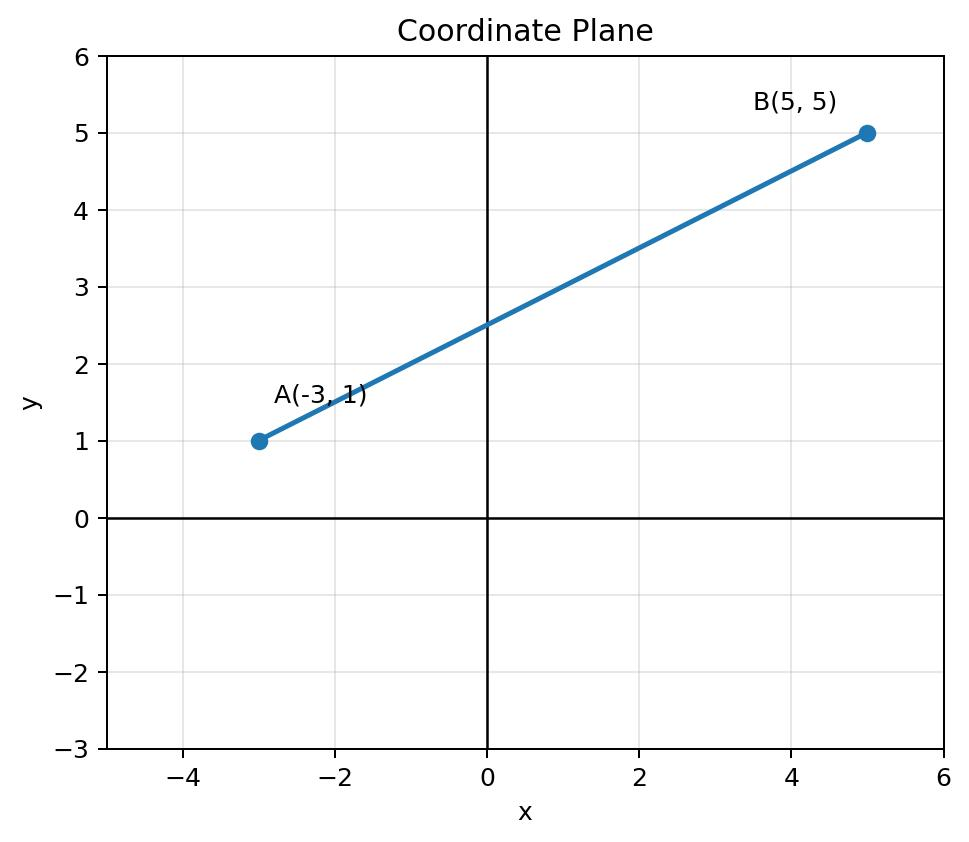

- **A.** (0, 3)
- **B.** (0, 2.5)
- **C.** (0, 5)
- **D.** (0, 4)

Answer
**C. (0, 5)**

**Q9.** 🆕 A square is inscribed in the circle shown, which has radius 3. What is the area of the square?

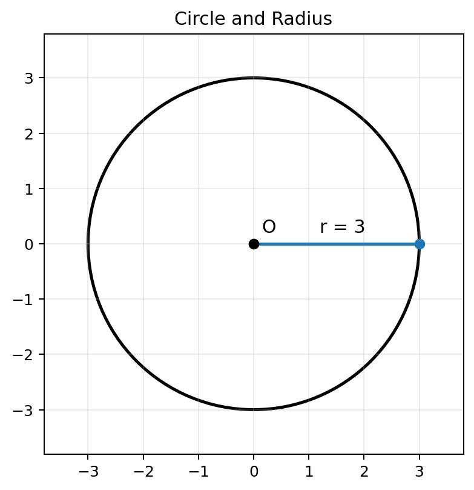

- **A.** 9√2
- **B.** 36
- **C.** 12
- **D.** 18

Answer
**D. 18**

**Q10.** 🆕 In the right triangle shown (right angle at B, AB = 4, BC = 3, AC = 5), what is the length of the altitude from B to AC?

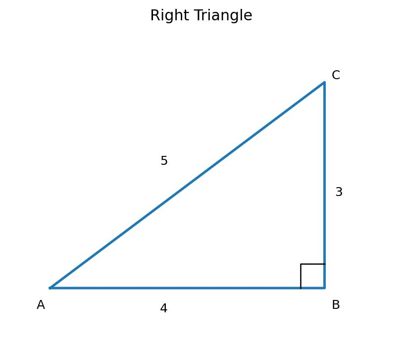

- **A.** 4/3
- **B.** 3
- **C.** 5/2
- **D.** 12/5

Answer
**D. 12/5**

**Q11.** What is the midpoint of the segment joining (-6, -5) and (-4, -4)?

- **A.** (-5, -0.5)
- **B.** (-1, -0.5)
- **C.** (-10, -9)
- **D.** (-5, -4.5)

Answer
**D. (-5, -4.5)**

**Q12.** If 4x + 7 = 15, what is the value of 2x − 3?

- **A.** 3
- **B.** 7
- **C.** 1
- **D.** -1

Answer
**C. 1**

**Q13.** 🆕 The rectangle shown has length 6 and width 3. What is the distance from a vertex not on the diagonal to the diagonal?

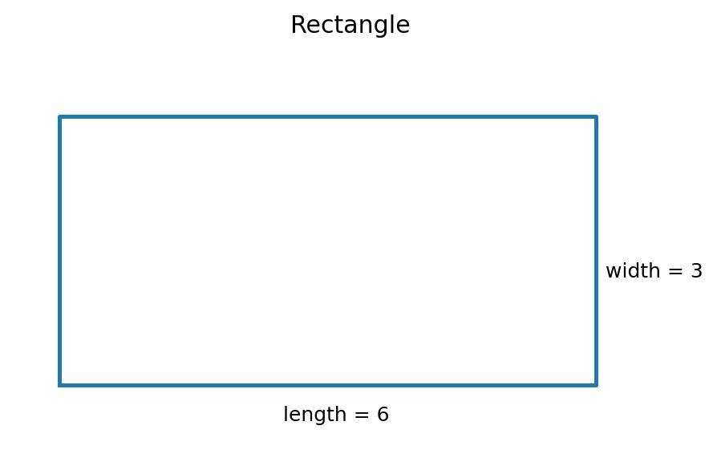

- **A.** 3√5/2
- **B.** 6√5/5
- **C.** 6/5
- **D.** 3

Answer
**B. 6√5/5**

**Q14.** Which is equivalent to (x² − 16)/(x − 4), for x ≠ 4?

- **A.** x + 16
- **B.** x + 4
- **C.** x² + 4
- **D.** x − 4

Answer
**B. x + 4**

**Q15.** An item costing $150 is sold at a 30% profit. What is its selling price?

- **A.** $195
- **B.** $45
- **C.** $180
- **D.** $105

Answer
**A. $195**

**Q16.** 🆕 How many 3-digit even numbers have three different digits?

- **A.** 360
- **B.** 450
- **C.** 328
- **D.** 288

Answer
**C. 328**

**Q17.** Evaluate: (4² − 7²)/(4 − 7), assuming 4 ≠ 7.

- **A.** -3
- **B.** 65
- **C.** 11
- **D.** 28

Answer
**C. 11**

**Q18.** 🆕 In an arithmetic sequence the 5th term is 17 and the 12th term is 45. What is the 20th term?

- **A.** 77
- **B.** 81
- **C.** 69
- **D.** 73

Answer
**A. 77**

**Q19.** 🆕 If log₂(x) + log₂(x − 2) = 3, what is x?

- **A.** 4
- **B.** 8
- **C.** 2
- **D.** −2

Answer
**A. 4**

**Q20.** 🆕 How many integers x satisfy |2x − 5| < 9?

- **A.** 8
- **B.** 14
- **C.** 9
- **D.** 7

Answer
**A. 8**

**Q21.** What is the midpoint of the segment joining (0, -1) and (-1, -1)?

- **A.** (-1, -2)
- **B.** (0.5, 0)
- **C.** (-0.5, 0)
- **D.** (-0.5, -1)

Answer
**D. (-0.5, -1)**

**Q22.** If 2x + 8 = 14, what is the value of 2x − 3?

- **A.** 5
- **B.** 9
- **C.** 0
- **D.** 3

Answer
**D. 3**

**Q23.** Simplify: √(400).

- **A.** 20
- **B.** 40
- **C.** 9
- **D.** 20√2

Answer
**A. 20**

**Q24.** Which is equivalent to (x² − 4)/(x − 2), for x ≠ 2?

- **A.** x² + 2
- **B.** x + 2
- **C.** x − 2
- **D.** x + 4

Answer
**B. x + 2**

**Q25.** An item costing $80 is sold at a 15% profit. What is its selling price?

- **A.** $68
- **B.** $92
- **C.** $12
- **D.** $95

Answer
**B. $92**

**Q26.** 🆕 What is the value of (1 + i)⁸, where i² = −1?

- **A.** 16
- **B.** −16
- **C.** 16i
- **D.** 8

Answer
**A. 16**

**Q27.** Evaluate: (7² − 6²)/(7 − 6), assuming 7 ≠ 6.

- **A.** 1
- **B.** 13
- **C.** 85
- **D.** 42

Answer
**B. 13**

**Q28.** 🆕 If the determinant of the matrix [[3, −2], [k, 5]] equals 7, what is k?

- **A.** −4
- **B.** 11/2
- **C.** 4
- **D.** −11/2

Answer
**A. −4**

**Q29.** 🆕 What is the maximum value of f(x) = x² − 4x + 3 on the interval 0 ≤ x ≤ 5?

- **A.** 3
- **B.** −1
- **C.** 5
- **D.** 8

Answer
**D. 8**

**Q30.** 🆕 A cylinder and a cone both have radius 3 and height 8. What is the volume of the cylinder minus the volume of the cone?

- **A.** 48π
- **B.** 72π
- **C.** 96π
- **D.** 24π

Answer
**A. 48π**

**Q31.** What is the midpoint of the segment joining (5, -3) and (6, 6)?

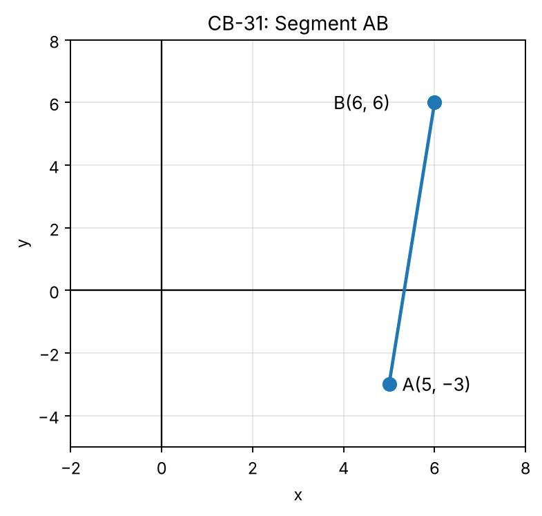

- **A.** (5.5, 1.5)
- **B.** (11, 3)
- **C.** (-0.5, -4.5)
- **D.** (5.5, -4.5)

Answer
**A. (5.5, 1.5)**

**Q32.** If 3x + 5 = 14, what is the value of 2x − 3?

- **A.** 9
- **B.** 3
- **C.** 0
- **D.** 5

Answer
**B. 3**

**Q33.** Simplify: √(324).

- **A.** 9
- **B.** 36
- **C.** 18
- **D.** 18√2

Answer
**C. 18**

**Q34.** 🆕 Adult tickets cost $12 and child tickets cost $7. A total of 50 tickets were sold for $475. How many adult tickets were sold?

- **A.** 35
- **B.** 30
- **C.** 20
- **D.** 25

Answer
**D. 25**

**Q35.** 🆕 After 5 tests, a student’s average score is 82. What score must the student earn on the 6th test to raise the average to exactly 84?

- **A.** 94
- **B.** 90
- **C.** 86
- **D.** 88

Answer
**A. 94**

**Q36.** 🆕 A bag has 4 red and 6 blue marbles. Three marbles are drawn without replacement. What is the probability that at least one is red?

- **A.** 2/3
- **B.** 1/6
- **C.** 5/6
- **D.** 3/4

Answer
**C. 5/6**

**Q37.** Evaluate: (8² − 3²)/(8 − 3), assuming 8 ≠ 3.

- **A.** 11
- **B.** 24
- **C.** 5
- **D.** 73

Answer
**A. 11**

**Q38.** 🆕 In triangle ABC, point D is on AB and point E is on AC with DE ∥ BC. If AD = 4, DB = 6 and DE = 5, what is BC?

- **A.** 10
- **B.** 30
- **C.** 15/2
- **D.** 25/2

Answer
**D. 25/2**

**Q39.** 🆕 The value of a machine is $800 and it loses 15% of its value each year. What is its value, in dollars, after 2 years?

- **A.** 578
- **B.** 680
- **C.** 560
- **D.** 600

Answer
**A. 578**

**Q40.** 🆕 Each exterior angle of a regular polygon measures 24°. What is the sum of the interior angles of the polygon, in degrees?

- **A.** 2,700
- **B.** 2,340
- **C.** 2,160
- **D.** 360

Answer
**B. 2,340**

**Q41.** What is the midpoint of the segment joining (-2, 0) and (4, 4)?

- **A.** (1, 2)
- **B.** (2, 4)
- **C.** (1, -2)
- **D.** (-3, -2)

Answer
**A. (1, 2)**

**Q42.** If 4x + 8 = 0, what is the value of 2x − 3?

- **A.** −1
- **B.** −6
- **C.** −7
- **D.** −5

Answer
**C. −7**

**Q43.** Simplify: √(256).

- **A.** 32
- **B.** 8
- **C.** 16√2
- **D.** 16

Answer
**D. 16**

**Q44.** 🆕 What is the sum of all real solutions of |x − 2| + |x + 3| = 9?

- **A.** −1
- **B.** −5
- **C.** 1
- **D.** 4

Answer
**A. −1**

**Q45.** An item costing $200 is sold at a 30% profit. What is its selling price?

- **A.** $140
- **B.** $230
- **C.** $260
- **D.** $60

Answer
**C. $260**

### Answer Key — Test 11: Combined Test (mixed)

| Q | Ans | Answer |
|---|---|---|
| 1 | A | (3, 1.5) |
| 2 | D | 3 |
| 3 | B | 8 |
| 4 | D | x = −1 or 3 |
| 5 | D | $180 |
| 6 | C | −4/3 |
| 7 | C | 6 |
| 8 | C | (0, 5) |
| 9 | D | 18 |
| 10 | D | 12/5 |
| 11 | D | (-5, -4.5) |
| 12 | C | 1 |
| 13 | B | 6√5/5 |
| 14 | B | x + 4 |
| 15 | A | $195 |
| 16 | C | 328 |
| 17 | C | 11 |
| 18 | A | 77 |
| 19 | A | 4 |
| 20 | A | 8 |
| 21 | D | (-0.5, -1) |
| 22 | D | 3 |
| 23 | A | 20 |
| 24 | B | x + 2 |
| 25 | B | $92 |
| 26 | A | 16 |
| 27 | B | 13 |
| 28 | A | −4 |
| 29 | D | 8 |
| 30 | A | 48π |
| 31 | A | (5.5, 1.5) |
| 32 | B | 3 |
| 33 | C | 18 |
| 34 | D | 25 |
| 35 | A | 94 |
| 36 | C | 5/6 |
| 37 | A | 11 |
| 38 | D | 25/2 |
| 39 | A | 578 |
| 40 | B | 2,340 |
| 41 | A | (1, 2) |
| 42 | C | −7 |
| 43 | D | 16 |
| 44 | A | −1 |
| 45 | C | $260 |

---

## Diagram index

| File | Used in |
|---|---|
| 01_coordinate_plane.jpg | CB-08 |
| 02_circle_radius.jpg | CB-09 |
| 03_right_triangle.jpg | CB-10 |
| 04_trig_triangle.jpg | (unused spare diagram) |
| 05_linear_graph.jpg | CB-06 |
| 06_parabola.jpg | CB-04 |
| 07_rectangle.jpg | CB-13 |
| 08_scatter_plot.jpg | SP-14, SP-15 |
| 09_probability_tree.jpg | SP-16 |
| 10_triangle_angles.jpg | (unused spare diagram) |
| 10_triangle_angles_corrected.jpg | (unused spare diagram) |
| 11_original_coordinate_plane.jpg | (unused spare diagram) |
| 12_original_circle_radius.jpg | (unused spare diagram) |
| 13_original_right_triangle.jpg | (unused spare diagram) |
| 14_original_trig_triangle.jpg | (unused spare diagram) |
| CB-31.jpg | CB-31 |
| PG-11.jpg | PG-11 |
| TR-05.jpg | TR-05 |